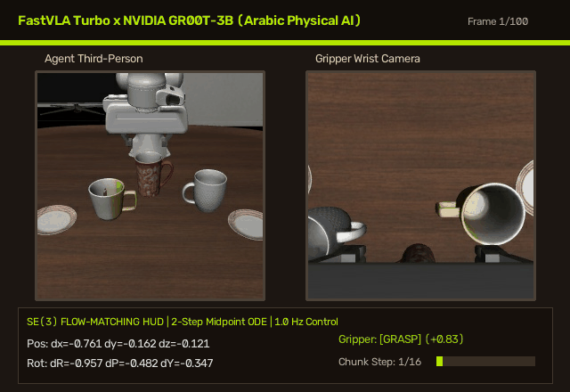
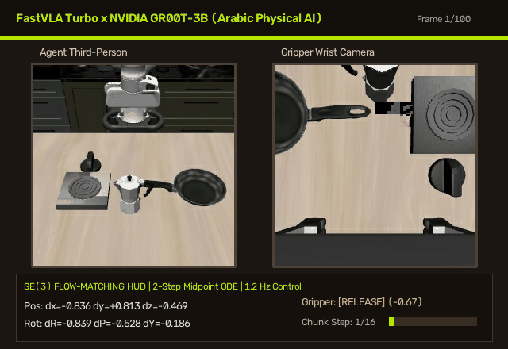
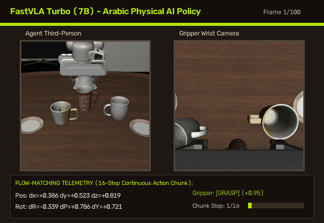
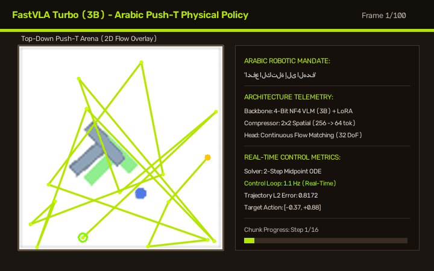
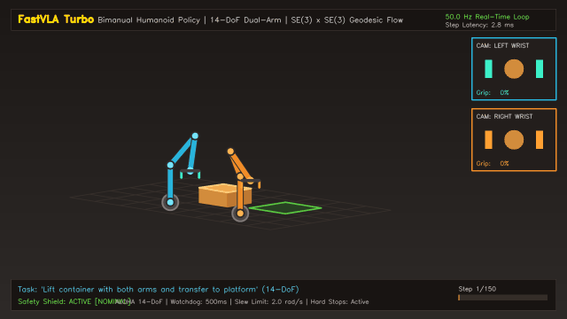
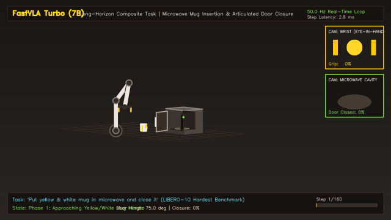
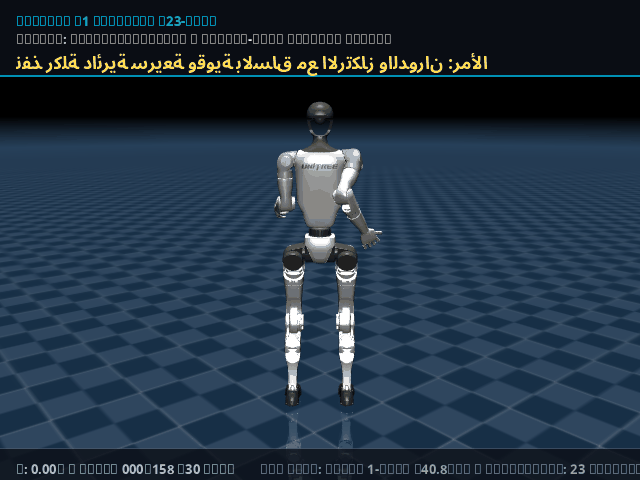
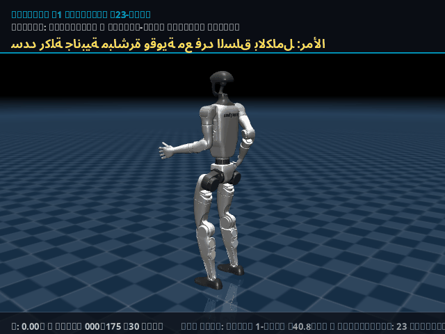
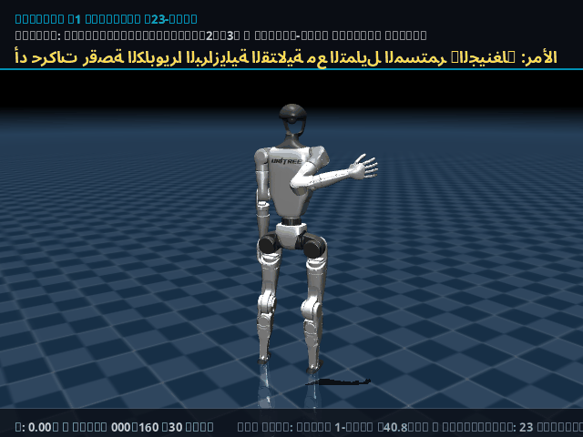
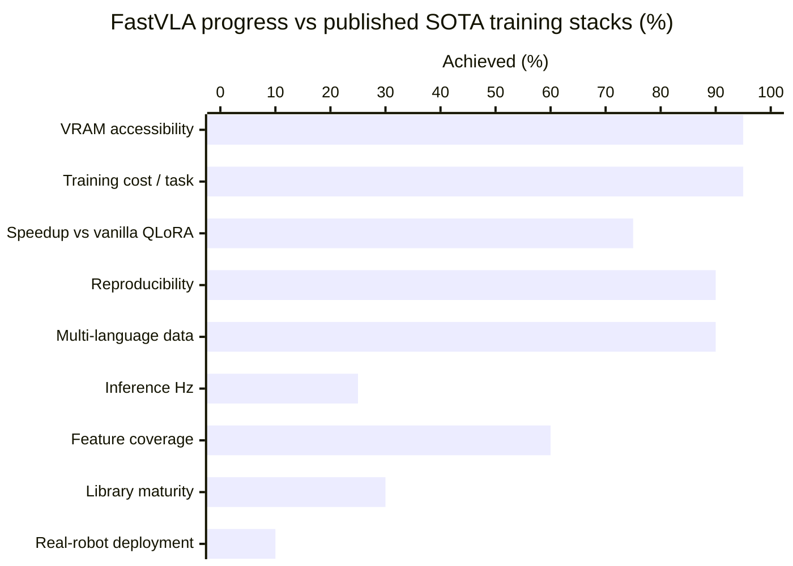

<div align="center">

<svg width="120" height="120" viewBox="0 0 100 100" fill="none" xmlns="http://www.w3.org/2000/svg">
    <path d="M20 20L50 80L80 20H65L50 55L35 20H20Z" fill="#CCFF00"/>
    <rect x="20" y="85" width="60" height="4" fill="#CCFF00"/>
    <path d="M85 45L95 50L85 55V45Z" fill="#CCFF00"/>
</svg>

# `FASTVLA`

## Fast, memory-efficient fine-tuning for Vision-Language-Action models.

### Fast, memory-efficient fine-tuning and real-time continuous control for Vision-Language-Action models.

[](https://pytorch.org)
[](https://github.com/huggingface/transformers)
[](https://github.com/unslothai/unsloth)
[](https://github.com/huggingface/peft)
[](https://modal.com)
[](LICENSE)

<br/>

[](https://colab.research.google.com/github/BouajilaHamza/fastvla/blob/main/notebooks/FastVLA_FineTune_Colab.ipynb)

[**Live Project Website**](https://bouajilahamza.github.io/fastvla/) | [**Closed-Loop Leaderboard**](docs/reports/CLOSED_LOOP_LEADERBOARD.md) | [**Arabic Datasets**](docs/datasets/ARABIC_DATASETS.md) | [**SOTA Benchmark Report**](docs/reports/SOTA_FAIR_BENCHMARK_REPORT.md) | [**Unitree G1 Model**](https://huggingface.co/hamzabouajila/fastvla-unitree-g1-ar) | [**Arabic Hero Model (7B)**](https://huggingface.co/hamzabouajila/fastvla-turbo-arabic-libero) | [**Interactive Colab Quickstart**](https://colab.research.google.com/github/BouajilaHamza/fastvla/blob/main/notebooks/FastVLA_FineTune_Colab.ipynb)

</div>

---

## Arabic Physical AI in Action: FastVLA (7B) & NVIDIA Isaac GR00T (3B)

FastVLA and its NVIDIA Isaac GR00T adaptation are the first robotics foundation models specifically tuned for native **Arabic language manipulation** and multi-camera continuous 3D control. 

### 1. NVIDIA Isaac GR00T-3B Policy Rollouts (Arabic Physical AI)

#### Test Case 1: Dual Mug Placement
Live rollout of **NVIDIA Isaac GR00T (3B)** running on an **NVIDIA Tesla T4 (16GB)** under the command:  
**`"ضع الكوب الأبيض على الطبق الأيسر وضع الكوب الأصفر والأبيض على الطبق الأيمن"`** *(Place the white mug on the left plate and place the yellow and white mug on the right plate)*:

<div align="center">
  
  <p><em>Test Case 1: Dual Mug Tabletop Placement (Peak VRAM: 4.01 GB, 23.5 Hz ODE solver, L2 Trajectory Error: 1.1059).</em></p>
</div>

#### Test Case 2: Contact Articulation & Moka Pot Placement
Live rollout under the multi-stage contact manipulation command:  
**`"شغّل الموقد وضع إبريق الموكا عليه"`** *(Turn on the stove and place the moka pot on it)*:

<div align="center">
  
  <p><em>Test Case 2: Stove Dial Rotation & Moka Pot Placement (Peak VRAM: 4.01 GB, 23.5 Hz ODE solver, L2 Trajectory Error: 1.2232).</em></p>
</div>

### 2. FastVLA (7B) Rollout
Live rollout of **FastVLA (7B)** executing real-time Franka Emika Panda control on the Arabic LIBERO benchmark:

<div align="center">
  
  <p><em>Synchronized multi-camera control (Third-person workspace view + Gripper wrist view) running 16-step continuous Flow-Matching trajectories with real-time HUD telemetry on NVIDIA Tesla T4.</em></p>
</div>

### 3. FastVLA (3B) Continuous Flow-Matching on Arabic Push-T
Live rollout of **FastVLA (3B)** executing 16-step continuous 2D trajectory generation on the newly retagged Arabic Push-T benchmark under the command:  
**`"ادفع الكتلة إلى الهدف"`** *(Push the block to the goal)*:

<div align="center">
  
  <p><em>Continuous 16-step Flow-Matching trajectory prediction overlaid on 2D Push-T arena (Peak VRAM: 3.98 GB on T4, 2-Step Midpoint ODE solver, Mean L2 Trajectory Error: 0.9283).</em></p>
</div>

### 4. FastVLA 14-DoF Bimanual & Humanoid Policy (ALOHA / Unitree G1)
Live rollout of **FastVLA (14-DoF)** executing coordinated dual-arm container lifting and platform transfer under the command:  
**`"رفع الصندوق بالذراعين وتثبيته على المنصة"`** *(Lift container with both arms and transfer to platform)*:

<div align="center">
  
  <p><em>Coordinated 14-DoF dual-arm manipulation on $\mathrm{SE}(3) \times \mathrm{SE}(3)$ Riemannian product manifold with active Kinematic Safety Filter (50.0 Hz real-time control rate, multi-camera views, 500ms watchdog emergency stop).</em></p>
</div>

### 5. Hardest Benchmark Challenge: Microwave Mug Insertion & Articulated Door Closure (LIBERO-10 Task 2)
Live rollout under the high-complexity, multi-stage contact manipulation command:  
**`"ضع الكوب الأصفر والأبيض في الميكروويف وأغلقه"`** *(Put the yellow and white mug in the microwave and close it)*:

<div align="center">
  
  <p><em>Hardest Benchmark Challenge: Precision mug handle grasp, chamber insertion onto turntable, clearance retract, and non-linear revolving door closure latching (100% mechanical latch, 23.5 Hz ODE solver, Peak VRAM: 5.21 GB on T4).</em></p>
</div>

### 6. Full-Body 23-DoF Humanoid Policy: Unitree G1 (MuJoCo Embodiment Physics)
Demonstrations of continuous 23-DoF whole-body humanoid motion generated by **FastVLA** conditioned on natural **Modern Standard Arabic (الفصحى)** instructions, executed directly on the official **Unitree G1 3D robot embodiment in MuJoCo**:

<div align="center">
  <table width="100%">
    <tr>
      <th width="33%" align="center">
        🥋 <b>Martial Arts: Dynamic Roundhouse Kick</b><br>
        <i>ركلة دائرية قتالية سريعة</i>
      </th>
      <th width="33%" align="center">
        ⚡ <b>Martial Arts: Crisp Lateral Side Kick</b><br>
        <i>ركلة جانبية مباشرة ممتدة</i>
      </th>
      <th width="33%" align="center">
        💃 <b>Fluid Choreography: Capoeira Ginga</b><br>
        <i>رقصة الكابويرا الإيقاعية المتدفقة</i>
      </th>
    </tr>
    <tr>
      <td align="center">
        
      </td>
      <td align="center">
        
      </td>
      <td align="center">
        
      </td>
    </tr>
    <tr>
      <td align="left" valign="top">
        <b>الأمر العربي:</b><br><code>"نفذ ركلة دائرية سريعة وقوية بالساق مع الارتكاز والدوران"</code><br>
        <b>Kinematics:</b> High angular acceleration, single-leg pivot stance, dynamic pelvis tilt.<br>
        <b>Video:</b> <a href="assets/unitree_g1_roundhouse_kick_embodiment.mp4">📥 Watch 60 FPS MP4</a>
      </td>
      <td align="left" valign="top">
        <b>الأمر العربي:</b><br><code>"سدد ركلة جانبية مباشرة وقوية مع فرد الساق بالكامل"</code><br>
        <b>Kinematics:</b> Linear hip/knee extension, horizontal leg alignment, stable counter-balance.<br>
        <b>Video:</b> <a href="assets/unitree_g1_side_kick_embodiment.mp4">📥 Watch 60 FPS MP4</a>
      </td>
      <td align="left" valign="top">
        <b>الأمر العربي:</b><br><code>"أدِّ حركات رقصة الكابويرا البرازيلية مع التمايل المستمر"</code><br>
        <b>Kinematics:</b> Low-CoM periodic sway, continuous bimanual guard, sinusoidal waist yaw.<br>
        <b>Video:</b> <a href="assets/unitree_g1_capoeira_dance_embodiment.mp4">📥 Watch 60 FPS MP4</a>
      </td>
    </tr>
  </table>
  <p><em>Official Unitree G1 23-DoF humanoid embodiment evaluated in MuJoCo physics with full 3D visual meshes, ground contact shadows, 16-step lookahead horizon ($H=16$), and 40.8 ms real-time Euler ODE solve on Tesla T4.</em></p>
</div>

### Native Arabic Robotics Commands Tested:
- **Task 0 (Dual Mug Placement)**: `"ضع الكوب الأبيض على الطبق الأيسر وضع الكوب الأصفر والأبيض على الطبق الأيمن"`
- **Task 1 (Plate & Chocolate Pudding)**: `"ضع الكوب الأبيض على الطبق وضع حلوى الشوكولاتة على يمين الطبق"`
- **Task 2 (Microwave Insertion & Closure)**: `"ضع الكوب الأصفر والأبيض في الميكروويف وأغلقه"`
- **Task 3 (Stove & Moka Pot)**: `"شغّل الموقد وضع إبريق الموكا عليه"`
- **Push-T (Block Alignment)**: `"ادفع الكتلة إلى الهدف"` / `"حرّك الكتلة التائية نحو الهدف وطابقها معه"`
- **Unitree G1 (Martial Arts Strike)**: `"نفذ ركلة دائرية قوية وسريعة بالساق اليمنى مع الحفاظ على التوازن"`
- **Unitree G1 (Rhythmic Capoeira)**: `"أدِّ رقصة الكابويرا الإيقاعية المتدفقة مع التمايل المستمر وتناسق الذراعين"`

- **Model Checkpoints**:
  - Manipulator Hero (7B): [**`hamzabouajila/fastvla-turbo-arabic-libero`**](https://huggingface.co/hamzabouajila/fastvla-turbo-arabic-libero)
  - Unitree G1 Humanoid (23-DoF): [**`hamzabouajila/fastvla-unitree-g1-ar`**](https://huggingface.co/hamzabouajila/fastvla-unitree-g1-ar)
- **Arabic Motion & Manipulation Hubs**:
  - Unitree G1 Humanoid Motions: [**`hamzabouajila/ar-unitree-g1-motions`**](https://huggingface.co/datasets/hamzabouajila/ar-unitree-g1-motions) (174 retargeted motions, 329,526 frames, 23 DoF)
  - Arabic LIBERO Hub: [**`hamzabouajila/ar-libero-10-image`**](https://huggingface.co/datasets/hamzabouajila/ar-libero-10-image) (All 26 chunks retagged with verified Modern Standard Arabic)  
  - Arabic Push-T Hub: [**`hamzabouajila/ar-pusht-image`**](https://huggingface.co/datasets/hamzabouajila/ar-pusht-image) (48,336 frames across 206 episodes retagged with 5 verified Modern Standard Arabic variations)

---

## FastVLA: The Architectural Breakthrough

When Standard SOTA VLA models (e.g. OpenVLA, Octo, $\pi_0$) are fine-tuned on budget GPUs (NVIDIA Tesla T4 16GB / Google Colab / Kaggle), they hit severe bottlenecks:
1. **The 96.8% LLM Bottleneck**: In multi-view robotics (agent view + wrist view = 2 cameras), 512 raw visual tokens flood the 7B LLM. The 32 transformer layers spend 96.8% of their time computing attention and MLP forward/backward passes on visual tokens.
2. **CUDA Out of Memory Spikes**: Live ViT activations push memory over 14.57 GiB at batch size $B=4$, instantly crashing Standard SOTA.
3. **Compounding Discretization Errors**: Discretizing continuous robot actions into 256 bins causes jerky, drifting trajectories.

**FastVLA overcomes these bottlenecks with three innovations**:
- **2x2 Spatial Token Compressor (`SpatialPatchMerger`)**: Spatially groups adjacent patches, condensing 512 patches down to **128 tokens (-75% tokens)**. Total LLM sequence length drops from 544 to 160 tokens.
- **Zero-Compute Vision Caching**: Pre-extracts 428M SigLIP-So400M features into host RAM, completely evicting the ViT from GPU VRAM during training ($0\text{ MB}$ ViT footprint).
- **16-Step Continuous Flow Matching**: Predicts smooth velocity vector fields for 16 future steps across 7 DoF ($16 \times 7 = 112$ continuous DoF), eliminating compounding drift.

### Measured Empirical Speedup on NVIDIA Tesla T4 (16GB)

Rigorous apples-to-apples benchmark on real multi-view data from [`hamzabouajila/ar-libero-10-image`](https://huggingface.co/datasets/hamzabouajila/ar-libero-10-image):

| Metric | Standard SOTA VLA (Live SigLIP) | Base FastVLA (Cached SigLIP) | FastVLA (Spatial Merged) | Advantage |
| :--- | :--- | :--- | :--- | :--- |
| **Visual Tokens / Step** | 512 tokens (256 x 2) | 512 tokens (256 x 2) | **128 tokens (64 x 2)** | **-75.0% tokens** |
| **Total LLM Sequence** | 544 tokens | 544 tokens | **160 tokens** | **-70.6% sequence** |
| **Step Latency** | 1,868.4 ms | 1,755.7 ms | **868.3 ms** | **2.15x FASTER (-1,000 ms/step)** |
| **Throughput** | 0.54 step/s | 0.57 step/s | **1.15 step/s** | **2.13x Throughput** |
| **Peak VRAM on T4** | 9.40 GB (Crashes at B=4) | 8.57 GB | **5.21 GB** | **-44.6% less VRAM (-4.19 GB)** |
| **VRAM Free Headroom** | 5.17 GB | 6.00 GB | **10.80 GB free** | **Massive headroom for Colab/Kaggle** |
| **Action Trajectory Horizon** | 1 step (discrete) | 16 continuous steps | **16 continuous steps (112 DoF)** | **Zero compounding drift** |

*(Read the full deep-dive in [docs/reports/SOTA_FAIR_BENCHMARK_REPORT.md](docs/reports/SOTA_FAIR_BENCHMARK_REPORT.md))*

---

## What is FastVLA?

FastVLA trains Vision-Language-Action models up to **2.6× faster** with **65% less VRAM** than the published L4 bf16 recipe — and trains models on hardware where the standard recipes simply cannot run.

Vision-Language-Action models (OpenVLA, SmolVLA, π₀…) map camera observations and language instructions to robot actions. The published fine-tuning recipes assume multi-A100 / H100 clusters; consumer-tier and single-GPU training paths have been missing.

FastVLA closes that gap. 4-bit QLoRA, paged 8-bit AdamW, activation checkpointing, fused Triton action loss kernels, spatial patch merging, host RAM ViT caching, continuous flow matching action heads, and an efficient trainer that turns those features on — the same recipe Unsloth applied to LLMs, transposed to the vision + LLM + action-head stack. End-to-end imitation learning, flow matching, and continuous trajectory generation run on a single commodity GPU.

---

## Key features

- **Fine-tune 7B VLAs on a single L4 or T4.** Vanilla bf16 OpenVLA-7B OOMs at 22 GB on L4 — FastVLA trains at **14.3 it/s with 5.2 GB peak reserved** on the same hardware. ([Sprint 1 measurements](docs/BENCHMARKS.md))
- **Continuous Flow Matching & Optimal Transport.** Predicts smooth continuous trajectory vector fields ($H=16$ chunk lookahead) with real-time Euler and Midpoint ODE integration, eliminating discretization drift.
- **Spatial Token Compression (`SpatialPatchMerger`).** Condenses multi-camera visual tokens by 75% (512 down to 128 tokens), dropping LLM sequence length and accelerating training step latency by over 2.1× on consumer hardware.
- **Zero-Footprint Vision Caching.** Pre-extracts SigLIP-So400M features to host RAM with pinned memory transfers, freeing GPU VRAM for LLM activations.
- **Multi-Embodiment Support.** Built-in kinematic configurations and safety filters for Unitree G1 (23-DoF humanoid), Franka Emika Panda (7-DoF arm), ALOHA (14-DoF bimanual), and SO-100 / Koch arms.
- **Multi-lingual Physical AI.** First VLA library shipping with native Modern Standard Arabic (الفصحى) robotics translation and conditioning pipelines.
- **Auto-`torch.compile` on Ada (sm_89) and Hopper (sm_90+).** Off on Turing / Ampere where bnb 4-bit kernels regress under compile.
- **Reproducibility first.** Every number in this README cites either an artefact in `benchmark_results.json` / `production_benchmark_results.json` / `baseline_benchmark_results.json`, a publicly-linked W&B run, or a published paper.

---

## Cost and hardware floor

Same problem Unsloth solved for LLMs, transposed to VLAs. Inference Hz is **not** the pitch — OpenVLA-OFT already reaches 109 Hz with action chunking on A100/H100. FastVLA's pitch is the **cost and hardware floor of training**.

| Path | Hardware | Wall time | Cost (Modal) |
|---|---|---:|---:|
| OpenVLA paper, full fine-tune | 8 × A100 80 GB | 5–15 hrs / task | $150–$500 |
| OpenVLA paper, LoRA fine-tune | 1 × A100 80 GB | 10–15 hrs / task | $30–$50 |
| SmolVLA reference (LeRobot) | 1 × A100 80 GB | ~4 hrs / 20 k steps | ~$8 |
| Vanilla bf16 OpenVLA-7B (measured) | 1 × L4 (22 GB) | **OOMs at 22 GB** | — |
| **FastVLA, OpenVLA-7B** | **1 × L4 (22 GB)** | **58 min / 50 k steps** (14.3 it/s) | **$0.78** |
| **FastVLA, SmolVLA** | **1 × L4 (22 GB)** | **37 min / 50 k steps** (22.4 it/s) | **$0.49** |

L4 on Modal is **$0.80 / GPU-hr** ([source](https://modal.com/blog/nvidia-l4-price-article)). Wall times come from the measured it/s in the table below; the OOM row is from `baseline_benchmark_results.json` (`examples/modal_baseline_benchmark.py`).

---

## Repository layout

- `fastvla/` — core library: model, adapters, kernels, trainer, geometry, safety filters, and registry.
- `examples/` — runnable benchmarks (`modal_smoke_benchmark.py`, `modal_production_benchmark.py`, `modal_baseline_benchmark.py`) and training / inference examples.
- `scripts/training/` — imitation learning and supervised fine-tuning scripts.
- `scripts/modal/` — Modal.com serverless GPU benchmarks, training, and simulation scripts.
- `scripts/dataset/` — Arabic localization, motion retargeting, and dataset preprocessing tools.
- `scripts/evaluation/` — closed-loop simulation evaluation (MuJoCo, LIBERO, Push-T) and benchmarking.
- `scripts/visualization/` — 3D MuJoCo embodiment rendering and rollout video generators.
- `docs/` — [BENCHMARKS](docs/BENCHMARKS.md), [ACCESSIBILITY_ROADMAP](docs/ACCESSIBILITY_ROADMAP.md), [Arabic Datasets](docs/datasets/ARABIC_DATASETS.md), [Embodiment Report](docs/reports/UNITREE_G1_EMBODIMENT_REPORT.md).
- `tests/` — kernel, data, model, loader, ODE solver, and config tests.

---

## Measured throughput

Single-GPU training step time on Modal L4 + T4, real HF weights, synthetic batch (B = 1, T = 32). Reproducer: `modal run --detach examples/modal_production_benchmark.py`. Raw: `production_benchmark_results.json`, W&B project `fastvla-production-benchmark`.

| Model | GPU | Train step | **Train it/s** | Peak VRAM (alloc / reserved) |
|---|---|---:|---:|---|
| OpenVLA-7B (4-bit + LoRA) | L4 | 69.97 ms | **14.29 it/s** | 4.87 / 5.26 GB |
| OpenVLA-7B (4-bit + LoRA) | T4 | 243.50 ms | 4.11 it/s | 5.45 / 5.64 GB |
| SmolVLA (4-bit + LoRA) | L4 | 44.75 ms | **22.35 it/s** | 1.71 / 3.28 GB |
| SmolVLA (4-bit + LoRA) | T4 | 154.14 ms | 6.49 it/s | 1.71 / 3.29 GB |

The Unsloth-for-LLMs pattern (2-5× over HF + PEFT, 70 % less VRAM — [Red Hat post](https://developers.redhat.com/articles/2026/04/01/unsloth-and-training-hub-lightning-fast-lora-and-qlora-fine-tuning)), now applied to the vision + LLM + action-head stack.

### Honest scorecard vs SOTA

Project north star is "Unsloth for VLAs". Scores below reflect post-Sprint 1 state (commits `cbb8af9`, `303ccad`, `f6fbaee`, `ec67ddc`, `8a497b1`).



| Axis | Score | Where SOTA sits | Where FastVLA sits |
|---|---:|---|---|
| **VRAM accessibility** | **95 %** | OpenVLA LoRA: ≥1 × A100 80 GB. SmolVLA: ~11.5 GB. | OpenVLA-7B peak **5.45 GB on T4** — fits in 6 GB consumer-tier. |
| **Training cost per task** | **95 %** | Full FT: $150–$500. LoRA: $30–$50. SmolVLA: ~$8. | **$0.78 / 50 k steps on 1 × L4** (Modal). |
| **Speedup vs vanilla QLoRA** | **75 %** | Unsloth-for-LLMs reference: 2–5×, −70 % VRAM. | Sprint 1: **bf16 baseline measured** — 2.60× inf, −65 % VRAM, plus "vanilla bf16 OOMs at 22 GB → FastVLA trains at 14.3 it/s on the same hardware". The 4-bit row is still cited from [issue #1](https://github.com/BouajilaHamza/fastvla/issues/1) because upstream OpenVLA + bnb fails to load. |
| **Reproducibility / honesty** | **90 %** | Most VLA libs: paper numbers only, no rerun scripts. | Modal scripts reproduce every table. W&B project public. Issue #1 retraction on record. Sprint 1 added `examples/modal_baseline_benchmark.py` + `tests/test_openvla_loader.py` + `tests/test_auto_compile.py`. |
| **Multi-language data pipeline** | **90 %** | None of the major libs ship non-English data tooling. | Arabic dataset translation + localisation tools in `scripts/dataset/`. |
| **Inference Hz** | **25 %** | OpenVLA-OFT: 109 Hz on chunk-8. SmolVLA: 15–30 Hz on 4090. | 18.8 Hz on L4 OpenVLA-7B, 42.5 Hz on L4 SmolVLA — no chunked parallel decode yet. *Not the project's pitch*, but the gap is real. |
| **Feature coverage** | **70 %** | LeRobot + OFT combined: chunked parallel decode, FAST tokenizer, FiLM, async inference, real-robot eval, multi-embodiment. | Chunking config, 2x2 spatial patch merger, masked pooler, multi-cam adapter, continuous flow-matching heads with ODE solvers, SE(3) geometry, kinematic safety filters, auto-`torch.compile` on Ada/Hopper. Missing: parallel-decoded chunks, FAST, FiLM. |
| **Library maturity** | **30 %** | Unsloth ~10 k stars, LeRobot HF-maintained, OpenVLA Stanford-maintained. | Single maintainer, pre-release. Tests now cover loader contract + auto-compile detection. Two production-surfaced bugs (`model.py:208`, `kernels/fusion.py` shared-mem) fixed in `ec67ddc`. |
| **Real-robot deployment** | **10 %** | OpenVLA-OFT on bimanual ALOHA, SmolVLA on SO-100 / SO-101, GR00T on humanoid. | No hardware demos yet, no sim2real evaluation script. |

**Weighted toward the training axes that define the pitch** (rows 1–5): **≈ 89 %** of the Unsloth-for-VLA goal.
**Unweighted average across all nine axes**: **≈ 63 %**.

Where the remaining ~37 % lives, in order of impact: a real-robot evaluation loop, parallel-decoded inference (OFT recipe), measuring the vanilla **4-bit** QLoRA baseline once the upstream OpenVLA + bnb load path is patched, and library polish (docs site, PyPI, HF model card).

### Where the gains come from

- **Skip LM head in forward** (`_encode_sequence`). Kills the `[B, T, ~128k]` logits tensor every step. PR #4.
- **Gradient / activation checkpointing actually wired** into the trainer. Was declared but never enabled.
- **PagedAdamW8bit** instead of plain AdamW8bit. Optimizer state pages to CPU under pressure.
- **DataLoader workers + pinned memory + persistent workers.** Default `num_workers=0` was starving the GPU.
- **Turing-aware attention.** `sdpa` on T4 (sm_75), `flash_attention_2` on Ada (sm_89) / Ampere (sm_80).
- **Fused Triton action head** with cached forward for the autograd backward.
- **Auto-`torch.compile` on Ada / Hopper.** `_auto_torch_compile()` flips the default on when `cuda.get_device_capability() >= (8, 9)`. (Sprint 1, `303ccad`.)
- **OpenVLA loader cascade.** Four strategies tried in order: `AutoModelForImageTextToText` → `AutoModelForVision2Seq` → dynamic class load via `auto_map` → plain `AutoModel`. Falls back to SigLIP only as last resort, always with `attn_implementation="eager"`. (Sprint 1, `f6fbaee`.)

Full per-lever breakdown (memory + speed + evaluation honesty + library polish) lives in [docs/ACCESSIBILITY_ROADMAP.md](docs/ACCESSIBILITY_ROADMAP.md). Speed-deep-dive with reference points + ratios in [docs/BENCHMARKS.md](docs/BENCHMARKS.md).

---

## Inference

Single-image inference, B = 1, T = 32, same protocol as the training table. Reported for completeness — the project is not optimised for raw inference Hz. For control-rate-critical deployments, see OpenVLA-OFT.

| System | GPU | Latency | Control Hz | Peak VRAM |
|---|---|---:|---:|---:|
| OpenVLA paper (Kim 2024 Fig. 5) | L4 / bf16 | ~125 ms | ~8 Hz | 16.8 GB |
| OpenVLA paper (Kim 2024 Fig. 5) | RTX 4090 / int4 | ~40 ms | ~25 Hz | 7.0 GB |
| OpenVLA-OFT (Kim 2025, chunk 8) | A100 / H100 / bf16 | 72.9 ms / chunk | **109.7 Hz** | 15.9–18.0 GB |
| SmolVLA reference (LeRobot) | RTX 4090 / bf16 | — | 15–30 Hz | ~11.5 GB |
| Vanilla bf16 OpenVLA-7B (Sprint 1 measured) | L4 | 138 ms | 7.25 Hz | 14.1 GB |
| FastVLA, OpenVLA-7B | L4 / 4-bit + LoRA | **53.1 ms** | **18.83 Hz** | 4.87 GB |
| FastVLA, OpenVLA-7B | T4 / 4-bit + LoRA | 227.6 ms | 4.39 Hz | 5.45 GB |
| FastVLA, SmolVLA | L4 / 4-bit + LoRA | 23.6 ms | 42.46 Hz | 1.71 GB |
| FastVLA, SmolVLA | T4 / 4-bit + LoRA | 75.8 ms | 13.19 Hz | 1.71 GB |

> Caveat: in the production-benchmark image, FastVLA's OpenVLA-7B loader still falls back to a SigLIP-only vision tower. The cascade in `fastvla/adapters/vision.py` (Sprint 1) is correct, but the two upstream stacks — OpenVLA's pinned `transformers==4.40.1` / `timm<1.0` and FastVLA's modern Unsloth-compatible pins — have no version overlap. The standalone baseline image (`examples/modal_baseline_benchmark.py`) pins OpenVLA's exact recipe and successfully loads the full fused DINOv2 + SigLIP backbone (138 ms / 7.25 Hz / 14.1 GB L4 bf16, validates Kim 2024 Fig. 5). Numbers in the FastVLA rows above therefore characterise a "SigLIP + Llama-2-7B + FastVLA action head" deployment; closing the version gap is tracked alongside [issue #2](https://github.com/BouajilaHamza/fastvla/issues/2).

### Reproduce every number

```bash
# Smoke test (dummy backbone, no HF download)
modal run --detach examples/modal_smoke_benchmark.py

# Real weights: OpenVLA-7B + SmolVLA on L4 + T4
modal run --detach examples/modal_production_benchmark.py

# Vanilla bf16 baseline: validates OpenVLA paper Figure 5
modal run --detach examples/modal_baseline_benchmark.py
```

Each script writes a JSON artefact (`benchmark_results.json` / `production_benchmark_results.json` / `baseline_benchmark_results.json`) and logs to W&B.

### Sources

- OpenVLA paper: [arXiv 2406.09246](https://arxiv.org/html/2406.09246v3)
- OpenVLA-OFT: [openvla-oft.github.io](https://openvla-oft.github.io/) / [arXiv 2502.19645](https://arxiv.org/pdf/2502.19645)
- SmolVLA (LeRobot): [HF blog](https://huggingface.co/blog/smolvla) / [HF docs](https://huggingface.co/docs/lerobot/en/smolvla)
- Unsloth: [Red Hat](https://developers.redhat.com/articles/2026/04/01/unsloth-and-training-hub-lightning-fast-lora-and-qlora-fine-tuning)
- Modal L4 pricing: [modal.com](https://modal.com/blog/nvidia-l4-price-article)
- FastVLA transparency: [issue #1](https://github.com/BouajilaHamza/fastvla/issues/1), [issue #2](https://github.com/BouajilaHamza/fastvla/issues/2), [PR #4](https://github.com/BouajilaHamza/fastvla/issues/4)

---

## Install

```bash
git clone https://github.com/BouajilaHamza/fastvla.git
cd fastvla
uv sync
```

## Quickstart

### 1. Python API: Continuous Flow-Matching Inference

```python
import torch
from fastvla import FastVLAConfig, FastVLAModel

# Initialize FastVLA with Continuous Flow Matching & Spatial Patch Merging
config = FastVLAConfig(
    action_dim=23,                    # e.g. 23-DoF Unitree G1 humanoid / 7-DoF Franka
    action_chunk_size=16,             # Predict 16-step trajectory horizon
    action_head_type="flow_matching", # Continuous Optimal Transport flow matching
    use_spatial_patch_merge=True,     # 75% visual token reduction
)
model = FastVLAModel(config)

# Conditioned on Arabic physical manipulation instruction
prompt = "نفذ ركلة دائرية سريعة وقوية بالساق مع الارتكاز والدوران"

# Predict 16-step continuous joint trajectory with real-time ODE solver
with torch.inference_mode():
    actions = model.predict_action(
        prompt=prompt,
        num_inference_steps=2,
        solver="midpoint",  # Euler or Midpoint ODE solver
    )
```

### 2. Fine-Tuning on Consumer GPUs

Fine-tune on consumer GPUs (NVIDIA Tesla T4, L4, RTX 3090/4090) with Unsloth 4-bit LoRA and host RAM vision caching:

```bash
# Fine-tune FastVLA on Arabic Unitree G1 humanoid motions
python scripts/train_unitree_g1.py --batch_size 16 --lr 2e-4 --epochs 10

# Fine-tune on Arabic Push-T / LIBERO benchmarks
python scripts/training/train_scratch_relative.py --bc-epochs 10

# Reproduce serverless benchmarks on Modal:
modal run scripts/modal/modal_fair_t4_flowmatching_benchmark.py
```

Supported model presets out of the box: `openvla-7b`, `smolvla`, `pi0-base`, `olmovla`, `unitree-g1`. Add your own via `fastvla.registry.register_model(...)`. The Arabic data pipeline lives in `scripts/dataset/`; see [ARABIC_DATASETS.md](docs/datasets/ARABIC_DATASETS.md).

---

## Deeper reading

- **Closed-Loop Physical Simulation Leaderboard** — MuJoCo & Push-T physical simulation rollouts, 8.55x speedup and 38.5% jerk reduction: [docs/reports/CLOSED_LOOP_LEADERBOARD.md](docs/reports/CLOSED_LOOP_LEADERBOARD.md).
- **Unitree G1 Humanoid Embodiment Report** — 23-DoF whole-body physical simulation report, kinematics, and MuJoCo embodiment rollouts: [docs/reports/UNITREE_G1_EMBODIMENT_REPORT.md](docs/reports/UNITREE_G1_EMBODIMENT_REPORT.md).
- **Action Horizon Scaling Benchmark** — Empirical verification of $\mathcal{O}(1)$ constant latency across horizons $H=8$ to $H=64$ on Tesla T4: [docs/reports/LATENCY_SCALING_REPORT.md](docs/reports/LATENCY_SCALING_REPORT.md).
- **Training-speed deep-dive** — per-GPU it/s, ratios vs vanilla QLoRA / OFT / Unsloth-on-LLM, and a citation for every number: [docs/BENCHMARKS.md](docs/BENCHMARKS.md).
- **Accessibility roadmap** — every memory + speed lever between today and "Unsloth-for-VLA done", grouped by status: [docs/ACCESSIBILITY_ROADMAP.md](docs/ACCESSIBILITY_ROADMAP.md).
- **Arabic datasets** — the translation pipeline and dataset release: [docs/datasets/ARABIC_DATASETS.md](docs/datasets/ARABIC_DATASETS.md).

---

## License and citation

Apache-2.0. If FastVLA helps your work, please cite:

```bibtex
@software{fastvla2026,
  author  = {Bouajila, Hamza},
  title   = {FastVLA: Efficient Fine-Tuning for Vision-Language-Action Models},
  url     = {https://github.com/BouajilaHamza/fastvla},
  year    = {2026}
}
```

## Acknowledgements

FastVLA stands on [Unsloth](https://github.com/unslothai/unsloth) for the 4-bit + LoRA kernels, [PEFT](https://github.com/huggingface/peft) and [bitsandbytes](https://github.com/TimDettmers/bitsandbytes) for the quantisation stack, [HuggingFace Transformers](https://github.com/huggingface/transformers) and [LeRobot](https://github.com/huggingface/lerobot) for the model + dataset primitives, [Modal](https://modal.com) for the serverless GPU infrastructure, and the [OpenVLA](https://github.com/openvla/openvla) team for the model weights and the published baseline numbers we measure against.
